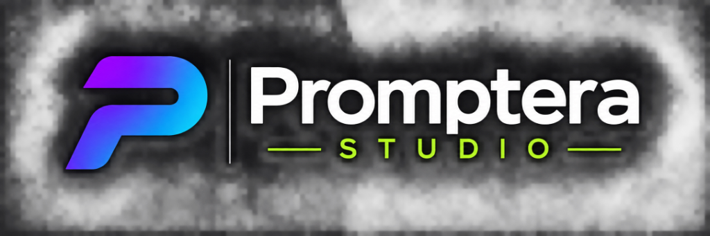

# Promptera Studio

Studio local para gerar vídeos com **MiniMax H3 + DaSiWa Continuity**: histórias e takes via API de IA, fila global, sync com runners externos, revisão take-a-take e masters concatenados sem empilhar Fulls do Continuity.

UI: [http://127.0.0.1:8790](http://127.0.0.1:8790)



## O que faz

- Biblioteca de projetos (SFW/NSFW) com filtros, capa e status (**Na fila** / **Gerando** / **Pronto**)
- Fila flutuante: **geração atual** (ligada ao que o Comfy está rodando) + **na fila** arrastável
- ETA calibrado (min/take, take atual, horário previsto, custo de energia)
- Continuity Full: master = último take da sessão (não concatena t01+t02+… de novo)
- Import inbox (`data/inbox/`) + runners externos (state JSON)
- Onboarding: LLM, ComfyUI, DaSiWa, modelos, ffmpeg, tarifa R$/kWh

## Requisitos

| Item | Notas |
|------|--------|
| Python 3.10+ | backend FastAPI |
| Node.js 18+ | build do frontend |
| ComfyUI + [ComfyUI-DaSiWa-Nodes](https://github.com/darksidewalker/ComfyUI-DaSiWa-Nodes) | Continuity H3 |
| Modelos MiniMax H3 | SFW obrigatório no onboarding; NSFW opcional |
| ffmpeg | no `PATH` |
| API de IA | OpenAI / compatível / Ollama / Anthropic |

GPU: ~12 GB VRAM confortável (ex.: RTX 3060). 8 GB possível, mais lento.

## Instalação

```powershell
git clone https://github.com/<seu-usuario>/Promptera-Studio.git
cd Promptera-Studio

python -m venv .venv
.\.venv\Scripts\Activate.ps1
pip install -r requirements.txt

cd frontend
npm install
npm run build
cd ..

python run.py
# ou: start.bat
```

Abra http://127.0.0.1:8790 e complete o **Config / Onboarding**.

### Rede / LAN

```powershell
$env:PROMPTERA_HOST="0.0.0.0"
$env:PROMPTERA_PORT="8790"
python run.py
```

## Fluxo rápido

1. Configure ComfyUI + chave de IA
2. **Nova história** (texto ou dado) **ou** solte `takes.json` em `data/inbox/<slug>/` — ver [CURSOR_INBOX.md](CURSOR_INBOX.md)
3. Enfileire → acompanhe a **Render queue**
4. Master em `data/deliverables/<slug>/master.mp4`

### Defaults Continuity

- 544×992 · 24 fps · euler · 8 steps · overlap 22 · `output_mode: full`
- Take 2–15 s (default 5) · blocos curtos (≤3–4 takes)

## Estrutura

```text
app/           # FastAPI, LLM, Continuity, fila, sync externo, ETA
frontend/      # React + Vite
bundled/       # workflows + seeds de estilo
data/          # SQLite, deliverables, inbox (não versionado)
scripts/       # utilitários de import/sync
run.py         # sobe em :8790
```

## Desenvolvimento

```powershell
# terminal A — API
python run.py

# terminal B — UI hot reload
cd frontend
npm run dev
```

Vite: http://127.0.0.1:5179 (proxy `/api` → 8790).

## Privacidade

- API keys e DB ficam só em `data/` (ignorados pelo Git)
- Não commite `.env`, `studio.db` nem vídeos de deliverables
- NSFW: capas não são geradas automaticamente

## Licença

Uso pessoal / local. Workflows de terceiros (DaSiWa, MiniMax) seguem as licenças dos autores originais.
